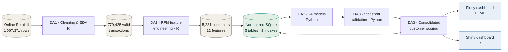

<div align="center">

# Customer Segmentation and Churn Prediction

### An end-to-end analytics pipeline on the Online Retail II dataset

**R → SQLite → Python → Interactive Dashboards**

[](https://www.python.org)
[](https://www.r-project.org)
[](https://scikit-learn.org)
[](https://sqlite.org)
[](https://plotly.com)
[](https://shiny.posit.co)


</div>

---

> [!NOTE]
> **The one-line version:** 1,067,371 raw transaction rows become 5,281 scored customers, a ranked retention list, and **GBP 3.67 million** of quantified revenue exposure — all reproducible from a seeded pipeline and explorable in two dashboards.

---

## Contents

| | Section |
|---|---|
| 01 | [What this project does](#what-this-project-does) |
| 02 | [Results at a glance](#results-at-a-glance) |
| 03 | [The pipeline](#the-pipeline) |
| 04 | [Repository structure](#repository-structure) |
| 05 | [How to run it](#how-to-run-it) |
| 06 | [The dashboards](#the-dashboards) |
| 07 | [Model comparison and statistical testing](#model-comparison-and-statistical-testing) |
| 08 | [Customer segments](#customer-segments) |
| 09 | [Risk, value and revenue exposure](#risk-value-and-revenue-exposure) |
| 10 | [What the numbers mean for a business](#what-the-numbers-mean-for-a-business) |
| 11 | [Database design](#database-design) |
| 12 | [Reproducibility](#reproducibility) |
| 13 | [Limitations](#limitations) |
| 14 | [Future scope](#future-scope) |
| 15 | [Tech stack](#tech-stack) |
| 16 | [References](#references) |
| 17 | [Author](#author) |

---

## What this project does

A UK-based online gift retailer has two years of transaction history and no idea which customers are about to stop buying. This project answers three questions from that history alone:

1. **Who is about to leave?** — a churn probability for every customer, from a model tested four different statistical ways rather than ranked on one lucky split.
2. **Which customers are worth keeping?** — behavioural segments and value tiers built from Recency, Frequency and Monetary features.
3. **So what do we actually do on Monday morning?** — one scored record per customer with a recommended retention action, queryable in SQL and explorable in a dashboard.

The work was carried out in three phases as a course project, each phase building on the last.

| Phase | Focus | Output |
|:--|:--|:--|
| **DA1** | Data cleaning and exploratory analysis | 1,067,371 → 779,425 valid transactions |
| **DA2** | Feature engineering, database design, modelling | 5,281 customer records, normalized SQLite, 24 trained models |
| **DA3** | Statistical validation, scoring, dashboards | Significance tests, customer scores, 2 dashboards, final report |

---

## Results at a glance

<div align="center">

| | | |
|:--:|:--:|:--:|
| **5,281** | **GBP 13.93M** | **GBP 3.67M** |
| customers scored | total lifetime value | revenue exposed to churn |
| **0.8070** | **569** | **26%** |
| best test ROC-AUC | customers flagged for urgent retention | of customer value at risk |

</div>

> [!IMPORTANT]
> **The central finding:** the customers most likely to churn are *not* the ones holding the most money. The 989 low-risk customers hold GBP 9.37M of lifetime value and are going nowhere. The 2,615 high-risk customers hold only GBP 2.02M — but because they are likely to leave, their probability-weighted exposure of **GBP 1.56M** is the largest of the three bands. Ranking by churn probability alone sends the retention budget to the wrong people.

---

## The pipeline



The database sits in the middle on purpose. R writes to it, Python reads from it and writes predictions back, and R reads it again for the dashboard — so neither language owns the data and every number in the report traces to one SQL query.

---

## Repository structure

```
Online-Retail-Analytics-Project/
│
├── Digital Assignment 1/                     # Cleaning and exploratory analysis
│   └── …                                     # DA1 script and report
│
├── Digital Assignment 2/                     # Features, database, modelling
│   ├── DA2_Phase1_FeatureEngineering_Database.R
│   ├── DA2_Phase2_DatabaseSchema.R
│   ├── DA2_ML_Models.ipynb
│   ├── DA2_Project_Report.docx
│   ├── DA2_Presentation.pptx
│   └── customer_features.csv
│
└── Digital Assignment 3/                     # Validation, scoring, dashboards
    ├── DA3_Final_Analysis.ipynb              # Statistics + scoring + dashboard build
    ├── DA3_Dashboard.html                    # Self-contained Plotly dashboard
    ├── DA3_Project_Report.docx / .pdf        # Final 30-page report
    ├── da2_retail_normalized.sqlite          # 5 tables, 9 indexes
    │
    ├── shiny_dashboard/
    │   ├── app.R                             # Reactive Shiny application
    │   └── *.csv                             # Data the app reads at startup
    │
    └── data/                                 # 11 exported result files
        ├── da3_final_comparison.csv          # Final metric table, 5 models
        ├── da3_cv_folds.csv                  # Per-fold cross-validation scores
        ├── da3_confidence_intervals.csv      # 95% t-intervals on mean fold score
        ├── da3_pairwise_tests.csv            # Paired t-test + Wilcoxon, 10 pairs
        ├── da3_mcnemar_matrix.csv            # Pairwise McNemar on test predictions
        ├── da3_bootstrap_ci.csv              # 1,000-resample percentile intervals
        ├── da3_customer_scores.csv           # All 5,281 scored customers
        ├── da3_segment_profiles.csv          # Segment means and churn rates
        ├── da3_risk_bands.csv                # Customers and exposure by band
        ├── da3_monthly_revenue.csv           # Monthly revenue and order counts
        └── da3_roc_points.csv                # ROC curve points for the dashboard
```

---

## How to run it

> [!WARNING]
> Run the phases **in order**. Each one writes the inputs the next one needs.

<details open>
<summary><b>Step 1 · Feature engineering and the initial database</b> &nbsp;·&nbsp; <code>R</code></summary>

<br/>

```r
# RStudio — Digital Assignment 2/
source("DA2_Phase1_FeatureEngineering_Database.R")
```

Reads the raw Online Retail II workbook, cleans it, builds RFM features and the three prediction targets.

**Produces:** `da2_retail.sqlite`, `customer_features.csv`

</details>

<details>
<summary><b>Step 2 · Normalized schema, indexes and benchmark</b> &nbsp;·&nbsp; <code>R</code></summary>

<br/>

```r
source("DA2_Phase2_DatabaseSchema.R")
```

Splits the flat table into `customers`, `products` and `transactions` with primary keys, foreign keys and CHECK constraints, then builds the indexes and benchmarks them.

**Produces:** `da2_retail_normalized.sqlite` — 3 tables, 5 indexes

</details>

<details>
<summary><b>Step 3 · Train and evaluate 24 models</b> &nbsp;·&nbsp; <code>Python / Colab</code></summary>

<br/>

Open `DA2_ML_Models.ipynb` in Google Colab, upload the database, and run all cells.

Covers three prediction tasks, hyperparameter tuning with `GridSearchCV`, decision-threshold optimisation, SMOTE, SHAP explainability and PCA.

**Produces:** the `ml_predictions` table and the model evaluation charts

</details>

<details>
<summary><b>Step 4 · Statistical validation, scoring and the Plotly dashboard</b> &nbsp;·&nbsp; <code>Python / Colab</code></summary>

<br/>

Open `DA3_Final_Analysis.ipynb` and run all cells.

Runs the four statistical procedures, scores every customer, writes the `customer_scores` table back to SQLite, exports the 11 CSVs and assembles the dashboard.

**Produces:** `data/da3_*.csv`, the `customer_scores` table, `DA3_Dashboard.html`

</details>

<details>
<summary><b>Step 5 · Launch the Shiny application</b> &nbsp;·&nbsp; <code>R</code></summary>

<br/>

```r
install.packages(c("shiny", "bslib", "plotly", "DT", "dplyr", "readr", "scales"))

setwd("Digital Assignment 3/shiny_dashboard")
shiny::runApp()
```

> [!TIP]
> `app.R` reads its CSV files from its own folder. If the app starts but the charts are empty, copy the `da3_*.csv` files from `data/` into `shiny_dashboard/` and restart.

</details>

<details>
<summary><b>No setup at all?</b> &nbsp;·&nbsp; <code>just open the HTML</code></summary>

<br/>

Download `DA3_Dashboard.html` and double-click it. The Plotly library is embedded in the file, so it needs no server, no internet connection and nothing installed.

</details>

---

## The dashboards

Two dashboards were built rather than one, because they answer the requirement in two different ways.

### Plotly · `DA3_Dashboard.html`

A single self-contained file with five summary tiles and five tabs. Works offline, in any browser, with nothing installed.

| Tab | What it shows |
|:--|:--|
| **Overview** | Revenue at risk by recommended action; customers and revenue by risk band |
| **Model comparison** | ROC-AUC with bootstrap intervals, cross-validation box plot, ROC curves, all three statistical test tables |
| **Segments** | Recency against spend, sized by order frequency; churn rate by segment |
| **Revenue** | Monthly revenue, monthly orders, exposure by value tier |
| **Retention list** | The twenty highest-value customers in the high-risk band |

### R Shiny · `shiny_dashboard/app.R`

Genuine server-side reactivity. Four sidebar filters — risk band, value tier, segment, and a minimum churn probability slider — feed a single reactive expression, so the tiles, all six tabs and the downloadable list recalculate together.

**The reactivity, demonstrated:**

| | Unfiltered | High risk + Platinum tier |
|:--|--:|--:|
| Customers | 5,281 | **126** |
| Revenue at risk | GBP 3,668,134 | **GBP 673,695** |
| Average churn risk | 0.566 | **0.762** |

Every chart redraws for the subset, and the filtered list exports to CSV through a download handler.

| Aspect | Plotly HTML | R Shiny |
|:--|:--|:--|
| Runs on | Any browser, offline | R session or Shiny server |
| Interactivity | Hover, zoom, tab switching | Full filtering and recomputation |
| Data handling | Fixed at build time | Recalculated on every filter change |
| Export | Static file, easy to share | CSV download of the filtered list |
| Best suited to | Sharing a fixed set of results | Exploring the customer base |

---

## Model comparison and statistical testing

Five churn models were compared on the same 1,321-customer test set and the same five stratified cross-validation folds.

| Model | Test ROC-AUC | Mean CV ROC-AUC | Recall | Accuracy |
|:--|--:|--:|--:|--:|
| Neural Network (MLP) | **0.8070** | **0.7964** | 0.8021 | 0.7441 |
| Gradient Boosting | 0.8054 | 0.7960 | **0.8088** | 0.7282 |
| Logistic Regression | 0.7973 | 0.7879 | 0.7821 | 0.7366 |
| Random Forest | 0.7872 | 0.7823 | 0.7901 | 0.7222 |
| XGBoost | 0.7722 | 0.7606 | 0.7741 | 0.7055 |

A gap of 0.0016 between the top two models is not a result — it is noise until tested. So four separate procedures were applied rather than one:

<details>
<summary><b>1 · Confidence intervals on the mean fold score</b> &nbsp;·&nbsp; t-distribution, 4 df</summary>

<br/>

| Model | 95% interval |
|:--|:--|
| Neural Network | 0.7856 – 0.8071 |
| Gradient Boosting | 0.7847 – 0.8074 |
| XGBoost | 0.7481 – 0.7731 |

The top two intervals overlap almost completely. XGBoost does not overlap with any other model, which makes it the clear weakest.

</details>

<details>
<summary><b>2 · Paired t-test and Wilcoxon signed-rank across folds</b> &nbsp;·&nbsp; all 10 pairs</summary>

<br/>

Eight of the ten comparisons are significant at the 5% level. The two that are not:

- Neural Network vs Gradient Boosting — mean difference 0.0003, **p = 0.8190**
- Logistic Regression vs Random Forest — p = 0.0852

With only five folds, Wilcoxon cannot produce a p-value below 0.0625, so it is reported as supporting evidence rather than as the decision rule.

</details>

<details>
<summary><b>3 · Pairwise McNemar tests on the test predictions</b></summary>

<br/>

McNemar asks a different question: on the individual customers where two models disagree, is the disagreement lopsided?

Here the Neural Network *does* separate from Gradient Boosting — correct on **58** customers that Gradient Boosting misclassifies, against **37** the other way, giving **p = 0.0402**.

</details>

<details>
<summary><b>4 · Bootstrap confidence intervals</b> &nbsp;·&nbsp; 1,000 resamples</summary>

<br/>

The test set was resampled with replacement 1,000 times and ROC-AUC recomputed each time. Every resulting interval is roughly **0.045 wide** — far larger than the 0.0016 separating the top two models.

</details>

### Reconciling the disagreement

The paired t-test says the top two models are equivalent; McNemar says they differ. Both are correct, because they measure different things:

- The **paired t-test** compares average ranking quality across five different partitions of the data — *would this model rank customers better on a fresh sample?*
- **McNemar** compares hard 0/1 predictions on one fixed set of customers at a fixed threshold — *do these two models make the same mistakes on these specific people?*

So the Neural Network makes measurably different errors on this particular test set, but across resampled folds its overall ranking ability is no better. The heavily overlapping bootstrap intervals support both readings.

### Why Gradient Boosting was shipped

With the two leaders statistically indistinguishable, selection fell to practical criteria:

- **Highest recall of all five models** at 0.8088 — and for churn, a missed churner is the expensive error
- **Already tuned** in DA2, where grid search and threshold optimisation at 0.453 lifted recall to 0.873
- **Cheaper and more stable** to retrain than a neural network, with fewer settings that affect stability

---

## Customer segments

K-Means with `k = 4` on scaled RFM features, fitted without any knowledge of churn — yet the segments separate churn behaviour cleanly, which is independent evidence that RFM captures something real.

| Segment | Customers | Avg. recency | Avg. frequency | Avg. spend | Churn rate | Reads as |
|:--:|--:|--:|--:|--:|--:|:--|
| **1** | 2,144 | 391.6 days | 2.2 | GBP 767 | `78.9%` | Dormant, largely lost |
| **2** | 246 | 32.9 days | 31.4 | GBP 17,069 | `8.9%` | Loyal high spenders |
| **3** | 2,876 | 86.7 days | 5.4 | GBP 1,980 | `44.3%` | Active regular buyers |
| **4** | 15 | 25.3 days | 153.0 | GBP 159,602 | `6.7%` | Elite wholesale accounts |

Churn rate falls from 78.9% to 6.7% in step with recency and frequency. Segment 1 customers last bought more than a year before the cutoff and ordered barely twice; most never return. Segment 4 is fifteen wholesale accounts averaging GBP 159,602 across 153 orders each, and almost all of them stay.

---

## Risk, value and revenue exposure

Every customer was scored with the tuned Gradient Boosting model at threshold 0.453, then given a risk band, a value tier (spend quartiles: Bronze, Silver, Gold, Platinum) and a **revenue at risk** figure — lifetime spend multiplied by churn probability.

| Risk band | Customers | Avg. probability | Lifetime value | Revenue at risk |
|:--|--:|--:|--:|--:|
| Low (below 0.3) | 989 | 0.154 | GBP 9,371,701 | GBP 976,223 |
| Medium (0.3 – 0.6) | 1,677 | 0.465 | GBP 2,539,303 | GBP 1,135,783 |
| High (above 0.6) | 2,615 | 0.787 | GBP 2,019,552 | **GBP 1,556,128** |
| **Total** | **5,281** | **0.566** | **GBP 13,930,556** | **GBP 3,668,134** |

Risk band and value tier together decide a recommended action — logic kept deliberately simple so it can be explained to a non-technical reader and changed without retraining anything.

| | Gold / Platinum | Bronze / Silver |
|:--|:--|:--|
| **High risk** | Urgent retention call | Automated win-back offer |
| **Medium risk** | Proactive engagement | Monitor |
| **Low risk** | Loyalty / upsell | Maintain |

The 2,046 customers marked for an automated win-back carry the highest average risk at 0.802 but only GBP 636,537 of value between them — an inexpensive channel is proportionate. The **569** customers marked for an urgent call carry **GBP 1,061,677** of exposure, almost a third of the total, which justifies individual human contact.

> The single largest exposure is customer `12346`: GBP 77,556 of lifetime spend at a churn probability of 0.902, placing **GBP 69,979** at risk from one account.

---

## What the numbers mean for a business

- **Act on exposure, not probability.** The highest-probability customers are mostly low-value. The 569 urgent-band customers hold GBP 1.06M between them and deserve individual attention.
- **Match the channel to the value.** An automated offer is proportionate for 2,046 low-value high-risk customers; a phone call is not.
- **Protect Segments 2 and 4.** Together, 261 customers holding roughly GBP 6.6M of lifetime value, with churn rates already low — the goal is not losing them, not winning them back.
- **Treat Segment 1 as win-back, not retention.** At 78.9% churn and GBP 767 average spend, these customers have effectively already left.

### Four findings that generalise beyond this dataset

1. **The features set the ceiling, not the algorithm.** Five very different models land between 0.7722 and 0.8070, and the top two are statistically indistinguishable.
2. **Defining the label honestly mattered more than any modelling choice.** A 90-day time-based split replaced an implausible 100% accuracy with a defensible 70–74%.
3. **Cheap adjustments beat expensive ones.** Moving the decision threshold raised recall by 0.064; a full grid search gained 0.002 of ROC-AUC.
4. **Value and risk must be combined.** The highest-risk customers are not the ones holding the most money.

---

## Database design

One normalized SQLite database is the single source of truth, shared between R and Python.

```
customers ──┐
            ├── transactions ──── products
            │
            ├── ml_predictions        (DA2 · Python)
            └── customer_scores       (DA3 · Python)
```

| Table | Rows | Written by | Added in |
|:--|--:|:--|:--|
| `customers` | 5,281 | R | DA2 |
| `products` | 4,631 | R | DA2 |
| `transactions` | 752,407 | R | DA2 |
| `ml_predictions` | 5,281 | Python | DA2 |
| `customer_scores` | 5,281 | Python | DA3 |

Primary keys, foreign keys and CHECK constraints throughout, with **9 indexes**.

**Measured effects:**

- Indexing cut a representative aggregate query from **0.289 s to 0.160 s** — a 1.81× speed-up
- Pushing aggregation into SQL returned **4 rows instead of 752,407** to Python, around 6.96× faster than loading everything into pandas first

---

## Reproducibility

Every random operation is seeded — `random_state = 42` in Python, `set.seed(42)` in R — covering the train-test split, K-Means initialisation, model fitting, cross-validation folds, SMOTE resampling and the bootstrap.

Two independent checks confirm the chain is deterministic:

- The R pipeline reproduces the DA1 row count of **779,425** exactly
- The DA3 model scores match those reported in DA2 to four decimal places

> [!NOTE]
> `da2_retail_normalized.sqlite` is about 85 MB. It pushes fine over `git`, but GitHub's browser uploader rejects files above 25 MB — use the command line or GitHub Desktop. If you would rather not store it at all, delete it and regenerate it by running Steps 1 and 2.

---

## Limitations

<details>
<summary><b>Read the honest list</b></summary>

<br/>

- Churn is defined by a single **90-day window**. A longer or shorter window changes both the labels and the reported accuracy.
- Performance **plateaus near 0.80 ROC-AUC**. The dataset carries no marketing, web-session, complaint or demographic data, so behavioural features alone set the limit.
- **Segment 4 has only fifteen customers**, which makes any statistic about it fragile.
- The segment classification task reaches ~0.99 accuracy because it relearns a boundary K-Means already drew from the same features — **not** independent validation of the clustering.
- Hyperparameter tuning was applied to the **churn task only**; the high-value and segment models still use defaults.
- Some **calibration curves deviate from the diagonal**, so raw probabilities should be calibrated before being used for budget calculations.
- **Revenue at risk uses historical spend**, not predicted future value, and no cost of intervention is modelled.
- The data is two years old and from a **single UK retailer** — the specific patterns should not be assumed to generalise.

</details>

---

## Future scope

- Add **time-dependent features** — inter-purchase gaps, three-month spend trend, seasonality — the most likely route past 0.80
- Replace the fixed label with a **survival model** that predicts *when* a customer will lapse, not just whether
- **Calibrate probabilities** with Platt scaling or isotonic regression so the risk bands mean what they say
- Extend tuning and SMOTE to the **high-value and segment tasks**
- Introduce a **cost matrix** with real offer costs and retained-customer margins, then optimise the threshold for profit rather than F1
- Deploy the Shiny app to **shinyapps.io** and schedule the scoring pipeline so scores refresh as transactions arrive
- **Validate the clustering** independently with silhouette analysis across values of `k`

---

## Tech stack

| Layer | Tools |
|:--|:--|
| **Data wrangling** | R · `dplyr`, `lubridate`, `readxl` · Python · `pandas`, `numpy` |
| **Database** | SQLite · `DBI` + `RSQLite` (R) · `sqlite3` (Python) |
| **Modelling** | `scikit-learn`, `XGBoost`, `LightGBM` |
| **Imbalance** | `imbalanced-learn` (SMOTE) |
| **Statistics** | `SciPy` (t-test, Wilcoxon) · `statsmodels` (McNemar) · `NumPy` (bootstrap) |
| **Explainability** | `SHAP`, PCA |
| **Visualisation** | `Plotly`, `matplotlib`, `seaborn` |
| **Dashboards** | Plotly HTML · R Shiny with `bslib`, `plotly`, `DT` |
| **Environment** | Google Colab, RStudio, Git |

---

## References

<details>
<summary><b>Full reference list</b></summary>

<br/>

Chang, W., Cheng, J., Allaire, J. J., Sievert, C., et al. (2024). *shiny: Web Application Framework for R.* https://shiny.posit.co

Chen, D. (2012). *Online Retail II* [Dataset]. UCI Machine Learning Repository. https://doi.org/10.24432/C5CG6D

Chen, T., & Guestrin, C. (2016). XGBoost: A scalable tree boosting system. *Proceedings of the 22nd ACM SIGKDD*, 785–794. https://doi.org/10.1145/2939672.2939785

Demšar, J. (2006). Statistical comparisons of classifiers over multiple data sets. *Journal of Machine Learning Research*, 7, 1–30.

Dietterich, T. G. (1998). Approximate statistical tests for comparing supervised classification learning algorithms. *Neural Computation*, 10(7), 1895–1923. https://doi.org/10.1162/089976698300017197

Efron, B., & Tibshirani, R. J. (1993). *An Introduction to the Bootstrap*. Chapman and Hall/CRC.

Harris, C. R., Millman, K. J., van der Walt, S. J., et al. (2020). Array programming with NumPy. *Nature*, 585(7825), 357–362. https://doi.org/10.1038/s41586-020-2649-2

Lundberg, S. M., & Lee, S.-I. (2017). A unified approach to interpreting model predictions. *NeurIPS 30*, 4765–4774.

McKinney, W. (2010). Data structures for statistical computing in Python. *Proceedings of the 9th Python in Science Conference*, 56–61. https://doi.org/10.25080/Majora-92bf1922-00a

McNemar, Q. (1947). Note on the sampling error of the difference between correlated proportions or percentages. *Psychometrika*, 12(2), 153–157. https://doi.org/10.1007/BF02295996

Nadeau, C., & Bengio, Y. (2003). Inference for the generalization error. *Machine Learning*, 52(3), 239–281. https://doi.org/10.1023/A:1024068626366

Pedregosa, F., Varoquaux, G., Gramfort, A., et al. (2011). Scikit-learn: Machine learning in Python. *Journal of Machine Learning Research*, 12, 2825–2830.

Plotly Technologies Inc. (2015). *Collaborative data science*. Montreal. https://plot.ly

Seabold, S., & Perktold, J. (2010). statsmodels: Econometric and statistical modeling with Python. *Proceedings of the 9th Python in Science Conference*, 92–96. https://doi.org/10.25080/Majora-92bf1922-011

Sievert, C. (2020). *Interactive Web-Based Data Visualization with R, plotly, and shiny*. Chapman and Hall/CRC.

Virtanen, P., Gommers, R., Oliphant, T. E., et al. (2020). SciPy 1.0: Fundamental algorithms for scientific computing in Python. *Nature Methods*, 17(3), 261–272. https://doi.org/10.1038/s41592-019-0686-2

Wilcoxon, F. (1945). Individual comparisons by ranking methods. *Biometrics Bulletin*, 1(6), 80–83. https://doi.org/10.2307/3001968

Xiahou, X., & Harada, Y. (2022). B2C e-commerce customer churn prediction based on K-Means and SVM. *Journal of Theoretical and Applied Electronic Commerce Research*, 17(2), 458–475. https://doi.org/10.3390/jtaer17020024

</details>

---

## Author

**Suyash Agrawaal**
B.Tech Data Science · Vellore Institute of Technology, Chennai

[](https://github.com/littlestuart07)
[](https://linkedin.com/in/suyash-agrawaal)

**Course:** Programming for Data Science (BCSE207L)
**Faculty:** Dr. Meignanamoorthi D
**Semester:** Fall 2026–2027

<br/>

<div align="center">

*Dataset from the UCI Machine Learning Repository. Built as coursework — code is free to read, learn from and adapt.*

</div>
