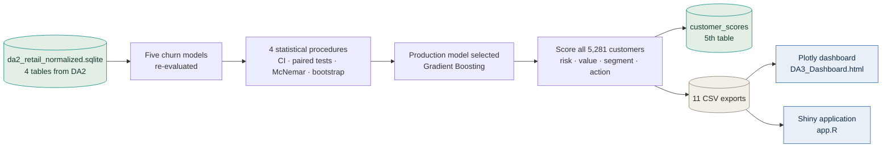

<div align="center">

# Digital Assignment 3 — Final Analysis, Dashboards and Conclusion

### Customer Segmentation and Churn Prediction · Online Retail II

**Statistical validation → Consolidated customer scoring → Two interactive dashboards**

[](https://www.python.org)
[](https://www.r-project.org)
[](https://scipy.org)
[](https://plotly.com)
[](https://shiny.posit.co)
[](https://sqlite.org)


</div>

---

> [!NOTE]
> **What this phase adds.** DA2 ended with two open questions: the leading churn models were separated by thousandths of a point of ROC-AUC on a single split, and the three model outputs — churn risk, value and segment — were still three separate results rather than one view a business could act on. DA3 answers both, then puts the answer in front of a user through two dashboards.

---

## Contents

| | Section |
|---|---|
| 01 | [Scope of this phase](#scope-of-this-phase) |
| 02 | [Results at a glance](#results-at-a-glance) |
| 03 | [What happens in this phase](#what-happens-in-this-phase) |
| 04 | [Folder contents](#folder-contents) |
| 05 | [How to run it](#how-to-run-it) |
| 06 | [Statistical validation](#statistical-validation) |
| 07 | [Consolidated customer scoring](#consolidated-customer-scoring) |
| 08 | [The dashboards](#the-dashboards) |
| 09 | [Result interpretation](#result-interpretation) |
| 10 | [Conclusion](#conclusion) |
| 11 | [Limitations](#limitations) |
| 12 | [Future scope](#future-scope) |
| 13 | [Reproducibility](#reproducibility) |
| 14 | [Tech stack](#tech-stack) |
| 15 | [References](#references) |

---

## Scope of this phase

Four deliverables, each answering a question DA2 left open.

| | Deliverable | Question it answers |
|:--:|:--|:--|
| **1** | Final performance comparison with statistical testing | Is the best model actually better, or did it get a lucky split? |
| **2** | Consolidated customer scoring view | What do we do about *this* customer on Monday morning? |
| **3** | Two interactive dashboards | Can a non-technical reader explore the result themselves? |
| **4** | Interpretation, limitations and conclusion | What does this mean, and where does it stop being trustworthy? |

> [!IMPORTANT]
> **Prerequisites.** This phase consumes outputs from the earlier assignments — `da2_retail_normalized.sqlite` with its `customers`, `products`, `transactions` and `ml_predictions` tables, plus the twelve engineered RFM features and the tuned Gradient Boosting model from DA2. Nothing here re-cleans the data or re-engineers features.

---

## Results at a glance

<div align="center">

| | | |
|:--:|:--:|:--:|
| **5,281** | **GBP 13.93M** | **GBP 3.67M** |
| customers scored | total lifetime value | revenue exposed to churn |
| **0.8070** | **569** | **26%** |
| best test ROC-AUC | flagged for urgent retention | of customer value at risk |

</div>

> [!IMPORTANT]
> **The central finding of this phase:** the customers most likely to churn are *not* the ones holding the most money. The 989 low-risk customers hold GBP 9.37M of lifetime value and are going nowhere. The 2,615 high-risk customers hold only GBP 2.02M — but because they are likely to leave, their probability-weighted exposure of **GBP 1.56M** is the largest of the three bands. Ranking by churn probability alone sends the retention budget to the wrong people.

---

## What happens in this phase



Both dashboards read the same CSV exports, so no figure on either one can drift from the numbers in the report.

---

## Folder contents

```
Digital Assignment 3/
│
├── DA3_Final_Analysis.ipynb           # Statistics + scoring + dashboard build
├── DA3_Dashboard.html                 # Self-contained Plotly dashboard
├── DA3_Project_Report.docx            # Final report, 30 pages
├── DA3_Project_Report.pdf             # PDF copy
├── da2_retail_normalized.sqlite       # Database, now 5 tables and 9 indexes
│
├── shiny_dashboard/
│   ├── app.R                          # Reactive Shiny application
│   └── *.csv                          # Data the app reads at startup
│
└── data/                              # 11 exported result files
    ├── da3_final_comparison.csv       # Final metric table, 5 models
    ├── da3_cv_folds.csv               # Per-fold cross-validation scores
    ├── da3_confidence_intervals.csv   # 95% t-intervals on mean fold score
    ├── da3_pairwise_tests.csv         # Paired t-test + Wilcoxon, 10 pairs
    ├── da3_mcnemar_matrix.csv         # Pairwise McNemar on test predictions
    ├── da3_bootstrap_ci.csv           # 1,000-resample percentile intervals
    ├── da3_customer_scores.csv        # All 5,281 scored customers
    ├── da3_segment_profiles.csv       # Segment means and churn rates
    ├── da3_risk_bands.csv             # Customers and exposure by band
    ├── da3_monthly_revenue.csv        # Monthly revenue and order counts
    └── da3_roc_points.csv             # ROC curve points for the dashboard
```

---

## How to run it

<details open>
<summary><b>Fastest route — just look at the dashboard</b> &nbsp;·&nbsp; <code>no setup</code></summary>

<br/>

Download `DA3_Dashboard.html` and double-click it. The Plotly library is embedded inside the file, so it needs no server, no internet connection and nothing installed.

</details>

<details>
<summary><b>Step 1 · Run the analysis notebook</b> &nbsp;·&nbsp; <code>Python / Colab</code></summary>

<br/>

Open `DA3_Final_Analysis.ipynb` in Google Colab, upload `da2_retail_normalized.sqlite`, then **Runtime → Run all**.

The notebook, in order:

1. Loads the features and predictions from SQLite
2. Re-evaluates the five churn models on an identical split and identical folds
3. Runs the four statistical procedures
4. Scores all 5,281 customers with risk band, value tier, revenue at risk and a recommended action
5. Writes `customer_scores` back into the database as a fifth table
6. Exports the 11 CSVs
7. Assembles `DA3_Dashboard.html`

**Produces:** `data/da3_*.csv`, the `customer_scores` table, `DA3_Dashboard.html`

</details>

<details>
<summary><b>Step 2 · Launch the Shiny application</b> &nbsp;·&nbsp; <code>R / RStudio</code></summary>

<br/>

```r
install.packages(c("shiny", "bslib", "plotly", "DT", "dplyr", "readr", "scales"))

setwd("Digital Assignment 3/shiny_dashboard")
shiny::runApp()
```

> [!TIP]
> `app.R` reads its CSV files from its own folder, not from `data/`. If the app starts but the charts come up empty, copy the `da3_*.csv` files into `shiny_dashboard/` and restart.

</details>

<details>
<summary><b>Optional · Query the scores directly in SQL</b></summary>

<br/>

```sql
SELECT recommended_action,
       COUNT(*)               AS customers,
       ROUND(SUM(monetary))   AS lifetime_value,
       ROUND(SUM(revenue_at_risk)) AS revenue_at_risk,
       ROUND(AVG(churn_probability), 3) AS avg_risk
FROM customer_scores
GROUP BY recommended_action
ORDER BY revenue_at_risk DESC;
```

The table carries a foreign key to `customers` and indexes on `customer_id` and `recommended_action`.

</details>

---

## Statistical validation

Five churn models were compared on the same 1,321-customer test set and the same five stratified cross-validation folds — identical folds are what make the paired tests valid.

| Model | Test ROC-AUC | Mean CV ROC-AUC | Recall | Accuracy |
|:--|--:|--:|--:|--:|
| Neural Network (MLP) | **0.8070** | **0.7964** | 0.8021 | 0.7441 |
| Gradient Boosting | 0.8054 | 0.7960 | **0.8088** | 0.7282 |
| Logistic Regression | 0.7973 | 0.7879 | 0.7821 | 0.7366 |
| Random Forest | 0.7872 | 0.7823 | 0.7901 | 0.7222 |
| XGBoost | 0.7722 | 0.7606 | 0.7741 | 0.7055 |

A gap of 0.0016 between the top two is not a result — it is noise until tested. So four separate procedures were applied rather than one.

<details>
<summary><b>1 · Confidence intervals on the mean fold score</b> &nbsp;·&nbsp; t-distribution, 4 df</summary>

<br/>

| Model | 95% interval |
|:--|:--|
| Neural Network | 0.7856 – 0.8071 |
| Gradient Boosting | 0.7847 – 0.8074 |
| XGBoost | 0.7481 – 0.7731 |

The top two intervals overlap almost completely, so the two cannot be separated on this evidence. The XGBoost interval overlaps with no other model, which makes it the clear weakest of the five.

</details>

<details>
<summary><b>2 · Paired t-test and Wilcoxon signed-rank across folds</b> &nbsp;·&nbsp; all 10 pairs</summary>

<br/>

Eight of the ten comparisons are significant at the 5% level. The two that are not:

- Neural Network vs Gradient Boosting — mean difference 0.0003, **p = 0.8190**
- Logistic Regression vs Random Forest — p = 0.0852

With only five folds, Wilcoxon cannot produce a p-value below 0.0625, so it is reported as supporting evidence rather than as the decision rule.

</details>

<details>
<summary><b>3 · Pairwise McNemar tests on the test predictions</b></summary>

<br/>

McNemar asks a different question: on the individual customers where two models disagree, is the disagreement lopsided? Only the two off-diagonal counts matter.

Here the Neural Network *does* separate from Gradient Boosting — correct on **58** customers that Gradient Boosting misclassifies, against **37** the other way, giving **p = 0.0402**. The largest gap of all is the Neural Network against XGBoost at p = 0.0008.

</details>

<details>
<summary><b>4 · Bootstrap confidence intervals</b> &nbsp;·&nbsp; 1,000 resamples</summary>

<br/>

The test set was resampled with replacement 1,000 times and ROC-AUC recomputed on each resample; the 2.5th and 97.5th percentiles give an interval that assumes no distribution at all.

Every interval is roughly **0.045 wide** — far larger than the 0.0016 separating the top two models. On its own, the bootstrap says the single-split ranking should not be read as a firm ordering at the top of the table.

</details>

### Reconciling the disagreement

The paired t-test says the top two models are equivalent; McNemar says they differ. Both are correct, because they measure different things:

- The **paired t-test** compares average ranking quality across five different partitions of the data — *would this model rank customers better on a freshly drawn sample?*
- **McNemar** compares hard 0/1 predictions on one fixed set of customers at a fixed threshold — *do these two models make the same mistakes on these specific people?*

So the Neural Network makes measurably different errors on this particular test set, but across resampled folds its overall ranking ability is not better. The heavily overlapping bootstrap intervals support both readings.

### Why Gradient Boosting was selected

With the two leaders statistically indistinguishable, selection fell to practical criteria:

- **Highest recall of all five models** at 0.8088 — and for churn, a missed churner is the expensive error
- **Already tuned** in DA2, where grid search and threshold optimisation at 0.453 lifted recall to 0.873
- **Cheaper and more stable** to retrain than a neural network, with fewer settings that affect stability

---

## Consolidated customer scoring

Every one of the 5,281 customers was scored with the tuned Gradient Boosting model at the optimised threshold of 0.453, then given three derived fields.

| Field | Definition |
|:--|:--|
| **Risk band** | Low below 0.3 · Medium 0.3 – 0.6 · High above 0.6 churn probability |
| **Value tier** | Quartiles of lifetime spend — Bronze, Silver, Gold, Platinum |
| **Revenue at risk** | Lifetime spend × churn probability |

Revenue at risk is the field that makes the view useful. A customer at 90% probability with GBP 200 of spend is a smaller problem than one at 60% with GBP 50,000 — and ranking by probability alone puts them the wrong way round.

| Risk band | Customers | Avg. probability | Lifetime value | Revenue at risk |
|:--|--:|--:|--:|--:|
| Low (below 0.3) | 989 | 0.154 | GBP 9,371,701 | GBP 976,223 |
| Medium (0.3 – 0.6) | 1,677 | 0.465 | GBP 2,539,303 | GBP 1,135,783 |
| High (above 0.6) | 2,615 | 0.787 | GBP 2,019,552 | **GBP 1,556,128** |
| **Total** | **5,281** | **0.566** | **GBP 13,930,556** | **GBP 3,668,134** |

### The action matrix

Risk band and value tier together decide the recommended action. The logic is deliberately simple so it can be explained to a non-technical reader and changed without retraining anything.

| | Gold / Platinum | Bronze / Silver |
|:--|:--|:--|
| **High risk** | Urgent retention call | Automated win-back offer |
| **Medium risk** | Proactive engagement | Monitor |
| **Low risk** | Loyalty / upsell | Maintain |

The 2,046 customers marked for an automated win-back carry the highest average risk at 0.802 but only GBP 636,537 of lifetime value between them, so an inexpensive channel is proportionate. The **569** customers marked for an urgent call carry **GBP 1,061,677** of revenue at risk — almost a third of the total — which justifies individual human contact.

> The single largest exposure is customer `12346`: GBP 77,556 of lifetime spend at a churn probability of 0.902, placing **GBP 69,979** at risk from one account.

The scoring view was written back into SQLite as `customer_scores`, the fifth table, with a foreign key to `customers` and indexes on `customer_id` and `recommended_action` — so the full chain R → SQLite → Python → SQLite stays intact.

---

## The dashboards

Two dashboards were built rather than one, because they answer the requirement in two different ways.

### Plotly · `DA3_Dashboard.html`

A single self-contained file with five summary tiles and five tabs. Works offline, in any browser, with nothing installed.

| Tab | What it shows |
|:--|:--|
| **Overview** | Revenue at risk by recommended action; customers and revenue by risk band |
| **Model comparison** | ROC-AUC with bootstrap intervals, cross-validation box plot, ROC curves, all three statistical test tables |
| **Segments** | Recency against spend, sized by order frequency; churn rate by segment; segment profile table |
| **Revenue** | Monthly revenue, monthly order count, exposure by value tier |
| **Retention list** | The twenty highest-value customers in the high-risk band |

### R Shiny · `shiny_dashboard/app.R`

Genuine server-side reactivity. Four sidebar filters — risk band, value tier, segment, and a minimum churn probability slider — feed a single reactive expression, so the summary tiles, all six tabs and the downloadable list recalculate together whenever a filter changes.

**The reactivity, demonstrated:**

| | Unfiltered | High risk + Platinum tier |
|:--|--:|--:|
| Customers | 5,281 | **126** |
| Revenue at risk | GBP 3,668,134 | **GBP 673,695** |
| Average churn risk | 0.566 | **0.762** |

Every chart redraws for the subset, and the filtered list exports to CSV through a download handler.

| Aspect | Plotly HTML | R Shiny |
|:--|:--|:--|
| Runs on | Any browser, offline | R session or Shiny server |
| Interactivity | Hover, zoom, tab switching | Full filtering and recomputation |
| Data handling | Fixed at build time | Recalculated on every filter change |
| Export | Static file, easy to share | CSV download of the filtered list |
| Best suited to | Sharing a fixed set of results | Exploring the customer base |

> [!TIP]
> The colour palette was checked for colour-blind separation, every chart carries hover tooltips, and each chart is paired with a table so values can also be read directly rather than estimated off an axis.

---

## Result interpretation

### Customer segments

The four K-Means segments turn out to be recognisable customer types rather than arbitrary groupings, and their churn rates differ sharply.

| Segment | Customers | Avg. recency | Avg. frequency | Avg. spend | Churn rate | Reads as |
|:--:|--:|--:|--:|--:|--:|:--|
| **1** | 2,144 | 391.6 days | 2.2 | GBP 767 | `78.9%` | Dormant, largely lost |
| **2** | 246 | 32.9 days | 31.4 | GBP 17,069 | `8.9%` | Loyal high spenders |
| **3** | 2,876 | 86.7 days | 5.4 | GBP 1,980 | `44.3%` | Active regular buyers |
| **4** | 15 | 25.3 days | 153.0 | GBP 159,602 | `6.7%` | Elite wholesale accounts |

Churn rate falls from 78.9% to 6.7% in step with recency and frequency. The segments were built from RFM values knowing nothing about churn, yet they separate churn behaviour cleanly — independent evidence that RFM captures something real about these customers.

### Behavioural drivers

Feature importance and SHAP from DA2 name Recency as the strongest predictor, followed by Frequency and the quantity measures, with country indicators contributing almost nothing. SHAP adds direction: high recency pushes a prediction towards churn, while high quantity and spend push it away.

The segment table says the same thing from a completely different angle — average recency rises from 25 days in Segment 4 to 392 days in Segment 1, and churn rate rises with it from 6.7% to 78.9%. Two independent methods agreeing on one driver is stronger evidence than either alone.

### Business reading

- **Act on exposure, not probability.** The highest-probability customers are mostly low-value. The 569 urgent-band customers hold GBP 1.06M between them and deserve individual attention.
- **Match the channel to the value.** An automated offer is proportionate for 2,046 low-value high-risk customers; a phone call is not.
- **Protect Segments 2 and 4.** Together, 261 customers holding roughly GBP 6.6M of lifetime value, with churn rates already low — the goal is not losing them, not winning them back.
- **Treat Segment 1 as a win-back problem, not a retention problem.** At 78.9% churn and GBP 767 average spend, these customers have effectively already left.

---

## Conclusion

Across three phases this project took a file of 1,067,371 raw transaction rows and ended with a ranked, actionable retention list stored in a queryable database. This phase tested the models properly, combined their outputs into one scoring view, and presented the whole thing through two dashboards.

**Four findings that generalise beyond this dataset:**

1. **The features set the ceiling, not the algorithm.** Five very different models land between 0.7722 and 0.8070, and the top two are statistically indistinguishable.
2. **Defining the label honestly mattered more than any modelling choice.** The 90-day time split replaced an implausible 100% accuracy with a defensible 70–74%.
3. **Cheap adjustments beat expensive ones.** Moving the decision threshold raised recall by 0.064; a full grid search gained 0.002 of ROC-AUC.
4. **Value and risk must be combined,** because the highest-risk customers are not the ones holding the most money.

The final output is concrete: **5,281 customers scored, GBP 3.67 million of revenue exposure quantified, and 569 customers named for immediate retention effort.**

---

## Limitations

<details>
<summary><b>Read the honest list</b></summary>

<br/>

- Churn is defined by a single **90-day window**. A longer or shorter window changes both the labels and the reported accuracy.
- Predictive performance **plateaus near 0.80 ROC-AUC**. The dataset carries no marketing, web-session, complaint or demographic data, so the behavioural features alone set the limit.
- **Segment 4 contains only fifteen customers**, which makes any statistic about that segment fragile.
- The segment classification task reaches about 0.99 accuracy because it relearns a boundary K-Means already drew from the same features — it is **not** independent validation of the clustering.
- Hyperparameter tuning was applied to the **churn task only**; the high-value and segment models still use default settings.
- Some **probability calibration curves deviate from the diagonal**, so raw probabilities should be calibrated before being used for budget calculations.
- **Revenue at risk is based on historical spend**, not predicted future value, and no cost of intervention is modelled.
- The data is two years old and from a **single UK retailer**, so the specific patterns should not be assumed to generalise.
- The action matrix is a reasonable business rule, **not an optimised policy** — the dataset contains no record of what retention offers cost or how often they succeed.

</details>

---

## Future scope

- Add **time-dependent features** — inter-purchase gaps, three-month spend trend, seasonality — the most likely route past 0.80
- Replace the fixed 90-day label with a **survival model** that predicts *when* a customer is likely to lapse rather than whether they lapse inside a fixed window
- **Calibrate probabilities** with Platt scaling or isotonic regression so the risk bands correspond to true probabilities
- Extend tuning and SMOTE experiments to the **high-value and segment tasks**
- Introduce a **cost matrix** with the real cost of a retention offer and the real margin on a retained customer, then optimise the threshold for profit rather than F1
- Deploy the Shiny application to **shinyapps.io** and schedule the scoring pipeline so scores refresh as new transactions arrive
- **Validate the clustering** independently with silhouette analysis across different values of `k`

---

## Reproducibility

Every random operation in this phase is seeded — `random_state = 42` in Python, `set.seed(42)` in R — covering the train-test split, cross-validation folds, model fitting and the 1,000 bootstrap resamples drawn with `np.random.default_rng(42)`.

Two independent checks confirm the chain is deterministic:

- The model scores in this phase match those reported in DA2 to four decimal places
- Both dashboards read the same CSV exports, so every figure shown traces back to one computation

> [!NOTE]
> `da2_retail_normalized.sqlite` is about 85 MB. It pushes fine over `git`, but GitHub's browser uploader rejects files above 25 MB — use the command line or GitHub Desktop. The database can also be regenerated from scratch by re-running the DA2 R scripts.

---

## Tech stack

| Layer | Tools |
|:--|:--|
| **Statistics** | `SciPy` — paired t-test, Wilcoxon · `statsmodels` — McNemar · `NumPy` — bootstrap |
| **Modelling** | `scikit-learn`, `XGBoost` — cross-validation and re-evaluation |
| **Scoring** | `pandas` — risk bands, value tiers, action matrix |
| **Database** | SQLite · `sqlite3` (Python) · `DBI` + `RSQLite` (R) |
| **Dashboard 1** | `Plotly` — self-contained interactive HTML |
| **Dashboard 2** | R Shiny with `bslib`, `plotly`, `DT` |
| **Environment** | Google Colab, RStudio, Git |

---

## References

<details>
<summary><b>Full reference list</b></summary>

<br/>

[1] Chang, W., Cheng, J., Allaire, J. J., Sievert, C., et al. (2024). *shiny: Web Application Framework for R.* https://shiny.posit.co

[2] Chen, D. (2012). *Online Retail II* [Dataset]. UCI Machine Learning Repository. https://doi.org/10.24432/C5CG6D

[3] Chen, T., & Guestrin, C. (2016). XGBoost: A scalable tree boosting system. *Proceedings of the 22nd ACM SIGKDD*, 785–794. https://doi.org/10.1145/2939672.2939785

[4] Demšar, J. (2006). Statistical comparisons of classifiers over multiple data sets. *Journal of Machine Learning Research*, 7, 1–30.

[5] Dietterich, T. G. (1998). Approximate statistical tests for comparing supervised classification learning algorithms. *Neural Computation*, 10(7), 1895–1923. https://doi.org/10.1162/089976698300017197

[6] Efron, B., & Tibshirani, R. J. (1993). *An Introduction to the Bootstrap*. Chapman and Hall/CRC.

[7] Harris, C. R., Millman, K. J., van der Walt, S. J., et al. (2020). Array programming with NumPy. *Nature*, 585(7825), 357–362. https://doi.org/10.1038/s41586-020-2649-2

[8] Lundberg, S. M., & Lee, S.-I. (2017). A unified approach to interpreting model predictions. *NeurIPS 30*, 4765–4774.

[9] McKinney, W. (2010). Data structures for statistical computing in Python. *Proceedings of the 9th Python in Science Conference*, 56–61. https://doi.org/10.25080/Majora-92bf1922-00a

[10] McNemar, Q. (1947). Note on the sampling error of the difference between correlated proportions or percentages. *Psychometrika*, 12(2), 153–157. https://doi.org/10.1007/BF02295996

[11] Nadeau, C., & Bengio, Y. (2003). Inference for the generalization error. *Machine Learning*, 52(3), 239–281. https://doi.org/10.1023/A:1024068626366

[12] Pedregosa, F., Varoquaux, G., Gramfort, A., et al. (2011). Scikit-learn: Machine learning in Python. *Journal of Machine Learning Research*, 12, 2825–2830.

[13] Plotly Technologies Inc. (2015). *Collaborative data science*. Montreal. https://plot.ly

[14] Seabold, S., & Perktold, J. (2010). statsmodels: Econometric and statistical modeling with Python. *Proceedings of the 9th Python in Science Conference*, 92–96. https://doi.org/10.25080/Majora-92bf1922-011

[15] Sievert, C. (2020). *Interactive Web-Based Data Visualization with R, plotly, and shiny*. Chapman and Hall/CRC.

[16] Virtanen, P., Gommers, R., Oliphant, T. E., et al. (2020). SciPy 1.0: Fundamental algorithms for scientific computing in Python. *Nature Methods*, 17(3), 261–272. https://doi.org/10.1038/s41592-019-0686-2

[17] Wilcoxon, F. (1945). Individual comparisons by ranking methods. *Biometrics Bulletin*, 1(6), 80–83. https://doi.org/10.2307/3001968

[18] Xiahou, X., & Harada, Y. (2022). B2C e-commerce customer churn prediction based on K-Means and SVM. *Journal of Theoretical and Applied Electronic Commerce Research*, 17(2), 458–475. https://doi.org/10.3390/jtaer17020024

</details>

---

<div align="center">

**Suyash Agrawaal** · B.Tech Data Science · VIT Chennai

Programming for Data Science (BCSE207L) · Digital Assignment 3 · Fall 2026–2027

[](https://github.com/littlestuart07)
[](https://linkedin.com/in/suyash-agrawaal)

</div>
