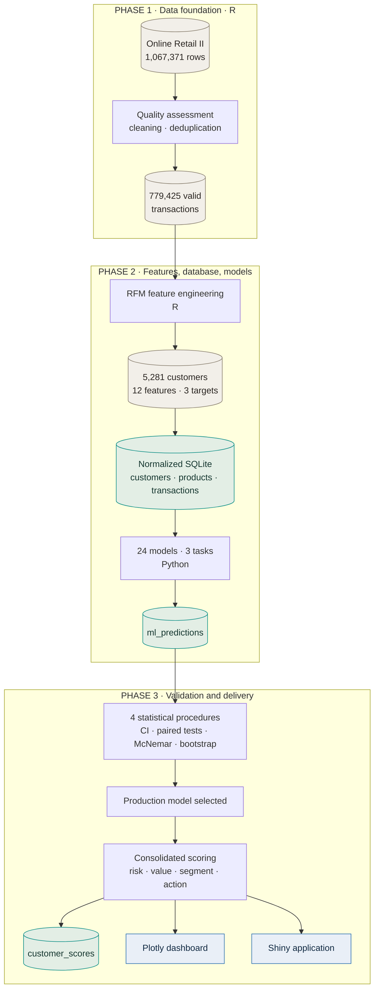

<div align="center">

<br/>

# Customer Segmentation & Churn Prediction

### Turning 1,067,371 raw transactions into a ranked retention list worth GBP 3.67 million

**A three-phase, end-to-end analytics project on the Online Retail II dataset**
`R` → `SQLite` → `Python` → `Interactive Dashboards`

<br/>

[](https://www.python.org)
[](https://www.r-project.org)
[](https://scikit-learn.org)
[](https://sqlite.org)
[](https://plotly.com)
[](https://shiny.posit.co)


<br/>

</div>

---

> [!NOTE]
> **The thirty-second version.** A UK online gift retailer has two years of transactions and no idea which customers are about to stop buying. This project cleans that history, engineers customer-level features, trains twenty-four models, proves statistically which one to trust, and ends with **one scored record per customer carrying a recommended retention action** — explorable in two dashboards and queryable in SQL. Total revenue exposed to churn: **GBP 3.67 million**, of which **GBP 1.06 million** sits with 569 named customers who warrant a phone call.

<br/>

<div align="center">

### Headline numbers

| | | | |
|:--:|:--:|:--:|:--:|
| **779,425** | **5,281** | **GBP 13.93M** | **GBP 3.67M** |
| valid transactions | customers scored | lifetime value | exposed to churn |
| **24** | **0.8070** | **569** | **26%** |
| models trained | best test ROC-AUC | urgent retention calls | of value at risk |

</div>

---

## Contents

| | Section | |
|---|---|---|
| **01** | [The problem](#the-problem) | Why this project exists |
| **02** | [Architecture](#architecture) | How the pieces fit together |
| **03** | [Phase 1 — Data foundation](#phase-1--data-foundation) | Cleaning and exploration |
| **04** | [Phase 2 — Features, database, models](#phase-2--features-database-and-models) | 24 models, normalized schema |
| **05** | [Phase 3 — Validation and delivery](#phase-3--validation-and-delivery) | Statistics, scoring, dashboards |
| **06** | [Repository structure](#repository-structure) | Where everything lives |
| **07** | [Quickstart](#quickstart) | Run it yourself |
| **08** | [The dashboards](#the-dashboards) | Plotly and Shiny |
| **09** | [Results and interpretation](#results-and-interpretation) | What the numbers say |
| **10** | [Four findings that generalise](#four-findings-that-generalise) | The transferable lessons |
| **11** | [Engineering decisions worth defending](#engineering-decisions-worth-defending) | Why, not just what |
| **12** | [Reproducibility](#reproducibility) | Seeded, verified |
| **13** | [Limitations](#limitations) | Where it stops being trustworthy |
| **14** | [Future scope](#future-scope) | What comes next |
| **15** | [Tech stack](#tech-stack) | Full tooling |
| **16** | [References](#references) | 18 sources |
| **17** | [Author](#author) | Contact |

---

## The problem

Retailers lose customers quietly. There is no cancellation event, no exit survey — a customer simply stops ordering, and by the time anyone notices, the relationship is months cold. The Online Retail II dataset captures exactly this situation: two years of invoices from a UK-based online gift retailer, December 2009 to December 2011, and nothing else. No marketing data, no support tickets, no demographics.

This project asks whether transaction history alone is enough to answer three questions:

<table>
<tr>
<td width="33%" valign="top">

### Who is leaving?

A churn probability for every customer, from a model validated four different statistical ways rather than ranked on one lucky train-test split.

</td>
<td width="33%" valign="top">

### Who is worth keeping?

Behavioural segments and value tiers built from Recency, Frequency and Monetary features — the classic RFM framework, learned rather than hand-cut.

</td>
<td width="33%" valign="top">

### So what do we do?

One scored record per customer with a recommended action, ranked by revenue at risk rather than by probability, because those are not the same list.

</td>
</tr>
</table>

The short answer: **yes, but with a ceiling.** Behavioural features alone plateau near 0.80 ROC-AUC, and this project demonstrates that ceiling rather than hiding it behind a cherry-picked metric.

---

## Architecture



> [!TIP]
> **The database sits at the centre on purpose.** R writes to it, Python reads from it and writes predictions back, and R reads it again to drive the dashboard. Neither language owns the data, and every number in every report traces back to one SQL query rather than to a CSV someone edited by hand.

---

## Phase 1 — Data foundation

**Digital Assignment 1** · `R` · Data quality assessment and exploratory analysis

The raw workbook holds **1,067,371 rows**, and a meaningful share of them cannot be used for customer analysis. Phase 1 establishes what is usable and why.

| Removed | Reason |
|:--|:--|
| Cancellation invoices | Invoice numbers prefixed `C` are returns, not purchases |
| Rows with no Customer ID | Cannot be attributed to a customer, so useless for segmentation |
| Non-positive quantity or price | Data entry artefacts and adjustments, not sales |
| Exact duplicate rows | Double-counted line items |

**Result: 779,425 valid transactions** — the figure every later phase reconciles against, and the first reproducibility checkpoint in the project.

Exploratory analysis then established the shape of the business: the monthly revenue cycle, the long tail of one-time buyers against a small core of heavy repeat accounts, and the geographic concentration in the United Kingdom that later made country indicators nearly worthless as predictors.

---

## Phase 2 — Features, database and models

**Digital Assignment 2** · `R` + `Python` · Feature engineering, database design, machine learning

<details open>
<summary><b>Feature engineering — from transactions to customers</b></summary>

<br/>

779,425 transaction rows became **5,281 customer records** with twelve features built on the RFM framework:

| Group | Features |
|:--|:--|
| **Recency** | Days since the customer's last purchase before the cutoff |
| **Frequency** | Distinct invoice count |
| **Monetary** | Total lifetime spend |
| **Basket shape** | Total quantity, average order value, distinct products, average basket size |
| **Tenure** | Days between first and last purchase |
| **Behavioural flag** | Bulk-order indicator, derived from the IQR of order quantity |
| **Geography** | Country indicators |

Three prediction targets were defined on top of these:

| Target | Definition | Why it is honest |
|:--|:--|:--|
| **Churn** | No purchase in a 90-day holdout window after the cutoff | A *time-based* split — the model never sees the future it predicts |
| **High value** | Top quartile of lifetime spend | Simple, auditable threshold |
| **Segment** | K-Means cluster, `k = 4` on scaled RFM | Unsupervised, then learned as a classification task |

> [!IMPORTANT]
> **Why the customer count drops from 5,878 to 5,281.** A churn label needs a holdout window, so every customer must have purchase history *before* the cutoff date. The 597 customers whose only activity falls inside the holdout period cannot be labelled either way — including them would mean guessing their label, so they are excluded. This is a deliberate choice in favour of a defensible label, not data loss.

</details>

<details>
<summary><b>Database design — a normalized schema shared between two languages</b></summary>

<br/>

The flat transaction table was split into a properly normalized schema with primary keys, foreign keys and CHECK constraints throughout.

```
customers ──┐
            ├── transactions ──── products
            │
            ├── ml_predictions        (Phase 2 · Python)
            └── customer_scores       (Phase 3 · Python)
```

| Table | Rows | Written by | Added in |
|:--|--:|:--|:--|
| `customers` | 5,281 | R | DA2 |
| `products` | 4,631 | R | DA2 |
| `transactions` | 752,407 | R | DA2 |
| `ml_predictions` | 5,281 | Python | DA2 |
| `customer_scores` | 5,281 | Python | DA3 |

**Nine indexes, with the benefit measured rather than assumed:**

| Optimisation | Before | After | Gain |
|:--|--:|--:|--:|
| Indexing a representative aggregate query | 0.289 s | 0.160 s | **1.81×** |
| Aggregating in SQL instead of pandas | 752,407 rows returned | 4 rows returned | **≈6.96×** |

Pushing the `GROUP BY` into SQLite rather than loading everything into pandas is the difference between moving three quarters of a million rows across the boundary and moving four.

</details>

<details>
<summary><b>Modelling — 24 models across 3 tasks</b></summary>

<br/>

Eight algorithms were trained on each of the three targets: Logistic Regression, Decision Tree, Random Forest, Gradient Boosting, XGBoost, LightGBM, Neural Network (MLP) and a Stacking ensemble.

On top of the baseline sweep:

- **`GridSearchCV`** hyperparameter tuning on the churn task
- **Decision-threshold optimisation** — moving the cutoff from 0.5 to **0.453** lifted recall to **0.873**
- **SMOTE** oversampling, 793 → 3,167 minority samples, to test whether class balance was the bottleneck
- **SHAP** values and feature importance for explainability
- **PCA** and calibration curves for diagnostics

> [!WARNING]
> **The most important result in Phase 2 was a correction, not a score.** An early churn definition produced ~100% accuracy — which is a red flag, not a triumph. The label was leaking the answer. Replacing it with a strict 90-day time-based holdout dropped accuracy to a believable **70–74%**, and that honest number is what the rest of the project is built on.

</details>

---

## Phase 3 — Validation and delivery

**Digital Assignment 3** · `Python` + `R` · Statistical testing, consolidated scoring, dashboards

Phase 2 ranked models by ROC-AUC on one split. A gap of 0.0016 between the top two is noise until tested — so Phase 3 tested it four ways.

| Model | Test ROC-AUC | Mean CV ROC-AUC | Recall | Accuracy |
|:--|--:|--:|--:|--:|
| Neural Network (MLP) | **0.8070** | **0.7964** | 0.8021 | 0.7441 |
| Gradient Boosting | 0.8054 | 0.7960 | **0.8088** | 0.7282 |
| Logistic Regression | 0.7973 | 0.7879 | 0.7821 | 0.7366 |
| Random Forest | 0.7872 | 0.7823 | 0.7901 | 0.7222 |
| XGBoost | 0.7722 | 0.7606 | 0.7741 | 0.7055 |

All five share the same twelve features, the same stratified 75/25 split of 3,960 training and 1,321 test customers, and the same five cross-validation folds — identical folds are what make the paired tests valid.

<details>
<summary><b>1 · Confidence intervals on the mean fold score</b> &nbsp;·&nbsp; t-distribution, 4 df</summary>

<br/>

| Model | 95% interval |
|:--|:--|
| Neural Network | 0.7856 – 0.8071 |
| Gradient Boosting | 0.7847 – 0.8074 |
| XGBoost | 0.7481 – 0.7731 |

The top two intervals overlap almost completely, so the two cannot be separated on this evidence. The XGBoost interval overlaps with no other model, making it the clear weakest of the five.

</details>

<details>
<summary><b>2 · Paired t-test and Wilcoxon signed-rank across folds</b> &nbsp;·&nbsp; all 10 pairs</summary>

<br/>

Eight of the ten comparisons are significant at the 5% level. The two that are not:

- Neural Network vs Gradient Boosting — mean difference 0.0003, **p = 0.8190**
- Logistic Regression vs Random Forest — p = 0.0852

With only five folds, Wilcoxon cannot produce a p-value below 0.0625, so it is reported as supporting evidence rather than as the decision rule — a limit of the test, stated rather than glossed over.

</details>

<details>
<summary><b>3 · Pairwise McNemar tests on the test predictions</b></summary>

<br/>

McNemar asks a different question: among the individual customers where two models disagree, is the disagreement lopsided? Only the two off-diagonal counts matter.

Here the Neural Network *does* separate from Gradient Boosting — correct on **58** customers that Gradient Boosting misclassifies, against **37** in the other direction, giving **p = 0.0402**. The widest gap of all is Neural Network against XGBoost at p = 0.0008.

</details>

<details>
<summary><b>4 · Bootstrap confidence intervals</b> &nbsp;·&nbsp; 1,000 resamples</summary>

<br/>

The test set was resampled with replacement 1,000 times and ROC-AUC recomputed on each resample; the 2.5th and 97.5th percentiles give an interval that assumes no distribution at all.

Every interval is roughly **0.045 wide** — far larger than the 0.0016 separating the top two models. On its own, the bootstrap says the single-split ranking should not be read as a firm ordering at the top of the table.

</details>

### When two valid tests disagree

The paired t-test says the top two models are equivalent. McNemar says they differ. **Both are correct**, because they measure different things:

| | Paired t-test | McNemar |
|:--|:--|:--|
| **Compares** | Average ranking quality (ROC-AUC) | Hard 0/1 predictions at a fixed threshold |
| **Across** | Five different partitions of the data | One fixed set of customers |
| **Asks** | *Would this model rank better on a fresh sample?* | *Do these two models misclassify the same people?* |
| **Verdict here** | Equivalent, p = 0.8190 | Different, p = 0.0402 |

So the Neural Network makes measurably different errors on this particular test set, while across resampled folds its overall ranking ability is no better. The heavily overlapping bootstrap intervals support both readings simultaneously. Reconciling this — rather than quoting whichever test gave the nicer answer — is the analytical core of Phase 3.

### Why Gradient Boosting shipped anyway

With the two leaders statistically indistinguishable, selection fell to practical criteria:

- **Highest recall of all five models** at 0.8088 — and in churn, a missed churner is the expensive error
- **Already tuned**, with grid search and threshold optimisation at 0.453 lifting recall to 0.873
- **Cheaper and more stable** to retrain than a neural network, with fewer settings that affect stability

---

## Repository structure

```
Online-Retail-Analytics-Project/
│
├── README.md                                 ← you are here
│
├── Digital Assignment 1/                     # Phase 1 · Cleaning and EDA
│   └── …                                     #   R script and report
│
├── Digital Assignment 2/                     # Phase 2 · Features, DB, models
│   ├── DA2_Phase1_FeatureEngineering_Database.R
│   ├── DA2_Phase2_DatabaseSchema.R           #   Normalized schema + benchmark
│   ├── DA2_ML_Models.ipynb                   #   24 models, tuning, SHAP, PCA
│   ├── DA2_Project_Report.docx
│   ├── DA2_Presentation.pptx
│   └── customer_features.csv                 #   5,281 × 12 feature matrix
│
└── Digital Assignment 3/                     # Phase 3 · Validation and delivery
    ├── README.md                             #   Phase-specific documentation
    ├── DA3_Final_Analysis.ipynb              #   Statistics + scoring + dashboard
    ├── DA3_Dashboard.html                    #   Self-contained Plotly dashboard
    ├── DA3_Project_Report.docx / .pdf        #   Final 30-page report
    ├── da2_retail_normalized.sqlite          #   5 tables · 9 indexes
    │
    ├── shiny_dashboard/
    │   ├── app.R                             #   Reactive Shiny application
    │   └── *.csv                             #   Data the app reads at startup
    │
    └── data/                                 #   11 exported result files
        ├── da3_final_comparison.csv          #   Final metric table, 5 models
        ├── da3_cv_folds.csv                  #   Per-fold CV scores
        ├── da3_confidence_intervals.csv      #   95% t-intervals
        ├── da3_pairwise_tests.csv            #   Paired t + Wilcoxon, 10 pairs
        ├── da3_mcnemar_matrix.csv            #   Pairwise McNemar
        ├── da3_bootstrap_ci.csv              #   1,000-resample intervals
        ├── da3_customer_scores.csv           #   All 5,281 scored customers
        ├── da3_segment_profiles.csv          #   Segment means + churn rates
        ├── da3_risk_bands.csv                #   Exposure by band
        ├── da3_monthly_revenue.csv           #   Monthly revenue and orders
        └── da3_roc_points.csv                #   ROC curve points
```

---

## Quickstart

<details open>
<summary><b>Zero setup — just look at the result</b></summary>

<br/>

Download **`Digital Assignment 3/DA3_Dashboard.html`** and double-click it.

The Plotly library is embedded inside the file, so it needs no server, no internet connection and nothing installed. Five tabs, five KPI tiles, every figure in the final report.

</details>

<details>
<summary><b>Full pipeline — five steps, in order</b></summary>

<br/>

> [!WARNING]
> Each step writes the inputs the next one needs. Run them in sequence.

**Step 1 · Feature engineering** — `R`
```r
source("DA2_Phase1_FeatureEngineering_Database.R")
# → da2_retail.sqlite, customer_features.csv
```

**Step 2 · Normalized schema and index benchmark** — `R`
```r
source("DA2_Phase2_DatabaseSchema.R")
# → da2_retail_normalized.sqlite (3 tables, 5 indexes)
```

**Step 3 · Train 24 models** — `Python / Colab`
```
Open DA2_ML_Models.ipynb → upload the database → Runtime → Run all
# → ml_predictions table, 14 chart outputs
```

**Step 4 · Statistics, scoring and the Plotly dashboard** — `Python / Colab`
```
Open DA3_Final_Analysis.ipynb → Runtime → Run all
# → data/da3_*.csv, customer_scores table, DA3_Dashboard.html
```

**Step 5 · Launch the Shiny application** — `R`
```r
install.packages(c("shiny", "bslib", "plotly", "DT", "dplyr", "readr", "scales"))
setwd("Digital Assignment 3/shiny_dashboard")
shiny::runApp()
```

> [!TIP]
> `app.R` reads its CSVs from its own folder, not from `data/`. If the app starts but the charts are empty, copy the `da3_*.csv` files into `shiny_dashboard/` and restart.

</details>

<details>
<summary><b>Query the scores directly in SQL</b></summary>

<br/>

```sql
SELECT recommended_action,
       COUNT(*)                         AS customers,
       ROUND(SUM(monetary))             AS lifetime_value,
       ROUND(SUM(revenue_at_risk))      AS revenue_at_risk,
       ROUND(AVG(churn_probability), 3) AS avg_risk
FROM customer_scores
GROUP BY recommended_action
ORDER BY revenue_at_risk DESC;
```

`customer_scores` carries a foreign key to `customers` and indexes on `customer_id` and `recommended_action`.

</details>

---

## The dashboards

Two were built rather than one, because "interactive dashboard" has two legitimate readings — a shareable artefact, and a live exploration tool.

### Plotly · `DA3_Dashboard.html`

A single self-contained file. Five summary tiles, five tabs, works offline in any browser with nothing installed.

| Tab | Contents |
|:--|:--|
| **Overview** | Revenue at risk by recommended action; customers and revenue by risk band |
| **Model comparison** | ROC-AUC with bootstrap intervals, CV box plot, ROC curves, all three statistical test tables |
| **Segments** | Recency against spend, sized by order frequency; churn rate by segment; profile table |
| **Revenue** | Monthly revenue, monthly order count, exposure by value tier |
| **Retention list** | The twenty highest-value customers in the high-risk band |

### R Shiny · `shiny_dashboard/app.R`

Genuine server-side reactivity. Four sidebar filters — risk band, value tier, segment, minimum churn probability — feed a single reactive expression, so the KPI tiles, all six tabs and the downloadable list recalculate **together**.

**The reactivity, demonstrated:**

| | Unfiltered | High risk + Platinum |
|:--|--:|--:|
| Customers | 5,281 | **126** |
| Revenue at risk | GBP 3,668,134 | **GBP 673,695** |
| Average churn risk | 0.566 | **0.762** |

Every chart redraws for the subset; the filtered list exports to CSV through a download handler.

| Aspect | Plotly HTML | R Shiny |
|:--|:--|:--|
| Runs on | Any browser, offline | R session or Shiny server |
| Interactivity | Hover, zoom, tab switching | Full filtering and recomputation |
| Data handling | Fixed at build time | Recalculated on every filter change |
| Export | Static file, easy to share | CSV download of the filtered selection |
| Best suited to | Presenting a fixed set of results | Exploring the customer base |

> [!TIP]
> The palette was validated for colour-blind separation, every chart carries hover tooltips, and each chart is paired with a table so values can be read exactly rather than estimated off an axis.

---

## Results and interpretation

### Customer segments

K-Means with `k = 4` on scaled RFM features, fitted knowing **nothing** about churn — yet the segments separate churn behaviour cleanly, which is independent evidence that RFM captures something real.

| Segment | Customers | Avg. recency | Avg. frequency | Avg. spend | Churn rate | Reads as |
|:--:|--:|--:|--:|--:|--:|:--|
| **1** | 2,144 | 391.6 days | 2.2 | GBP 767 | `78.9%` | Dormant, largely lost |
| **2** | 246 | 32.9 days | 31.4 | GBP 17,069 | `8.9%` | Loyal high spenders |
| **3** | 2,876 | 86.7 days | 5.4 | GBP 1,980 | `44.3%` | Active regular buyers |
| **4** | 15 | 25.3 days | 153.0 | GBP 159,602 | `6.7%` | Elite wholesale accounts |

Churn rate falls from 78.9% to 6.7% in step with recency and frequency. Segment 1 customers last bought more than a year before the cutoff and ordered barely twice — most never return. Segment 4 is fifteen wholesale accounts averaging GBP 159,602 across 153 orders each, and almost all of them stay.

### Risk, value and revenue exposure

Every customer was scored with the tuned Gradient Boosting model at threshold 0.453, then given a risk band, a value tier (spend quartiles: Bronze / Silver / Gold / Platinum) and a **revenue at risk** figure — lifetime spend × churn probability.

| Risk band | Customers | Avg. probability | Lifetime value | Revenue at risk |
|:--|--:|--:|--:|--:|
| Low (below 0.3) | 989 | 0.154 | GBP 9,371,701 | GBP 976,223 |
| Medium (0.3 – 0.6) | 1,677 | 0.465 | GBP 2,539,303 | GBP 1,135,783 |
| High (above 0.6) | 2,615 | 0.787 | GBP 2,019,552 | **GBP 1,556,128** |
| **Total** | **5,281** | **0.566** | **GBP 13,930,556** | **GBP 3,668,134** |

> [!IMPORTANT]
> **The two value columns point in opposite directions, and that is the central business insight of the project.** Most of the money — GBP 9.37M — sits with the 989 low-risk customers who are going nowhere. The high-risk band holds far less lifetime value at GBP 2.02M, but because those customers are likely to leave, their probability-weighted exposure of **GBP 1.56M** is the largest of the three bands. Ranking by churn probability alone sends the retention budget to the wrong people.

### The action matrix

Risk band and value tier together decide the recommended action. The logic is deliberately simple, so it can be explained to a non-technical stakeholder and changed without retraining anything.

| | Gold / Platinum | Bronze / Silver |
|:--|:--|:--|
| **High risk** | Urgent retention call | Automated win-back offer |
| **Medium risk** | Proactive engagement | Monitor |
| **Low risk** | Loyalty / upsell | Maintain |

The 2,046 customers marked for an automated win-back carry the highest average risk at 0.802 but only GBP 636,537 of lifetime value between them — an inexpensive channel is proportionate. The **569** customers marked for an urgent call carry **GBP 1,061,677** of revenue at risk, almost a third of the total, which justifies individual human contact.

> The single largest exposure is customer `12346`: GBP 77,556 of lifetime spend at a churn probability of 0.902, placing **GBP 69,979** at risk from one account.

### Behavioural drivers

Feature importance and SHAP both name **Recency** as the strongest predictor, followed by Frequency and the quantity measures, with country indicators contributing almost nothing. SHAP adds direction: high recency pushes a prediction towards churn, while high quantity and spend push it away.

The segment table says the same thing from a completely different angle — average recency rises from 25 days in Segment 4 to 392 days in Segment 1, and churn rate rises with it from 6.7% to 78.9%. Two independent methods agreeing on one driver is stronger evidence than either alone.

### What to do on Monday morning

- **Act on exposure, not probability.** The highest-probability customers are mostly low-value. The 569 urgent-band customers hold GBP 1.06M between them and deserve individual attention.
- **Match the channel to the value.** An automated offer is proportionate for 2,046 low-value high-risk customers; a phone call is not.
- **Protect Segments 2 and 4.** Together, 261 customers holding roughly GBP 6.6M of lifetime value, with churn rates already low — the goal is not losing them, not winning them back.
- **Treat Segment 1 as a win-back problem, not a retention problem.** At 78.9% churn and GBP 767 average spend, these customers have effectively already left.

---

## Four findings that generalise

<table>
<tr>
<td width="50%" valign="top">

### 1 · The features set the ceiling, not the algorithm

Five very different models — linear, tree ensemble, boosted, neural — land between 0.7722 and 0.8070, and the top two are statistically indistinguishable. Swapping algorithms was never going to break 0.80. Only new *kinds* of data would.

</td>
<td width="50%" valign="top">

### 2 · Defining the label honestly mattered most

The 90-day time-based split replaced an implausible 100% accuracy with a defensible 70–74%. No modelling choice in the entire project moved the result as much as getting the target definition right.

</td>
</tr>
<tr>
<td width="50%" valign="top">

### 3 · Cheap adjustments beat expensive ones

Moving the decision threshold from 0.5 to 0.453 raised recall by 0.064. A full grid search gained 0.002 of ROC-AUC. One took seconds; the other took the GPU session.

</td>
<td width="50%" valign="top">

### 4 · Value and risk must be combined

The highest-risk customers are not the ones holding the most money. A churn model that stops at a probability column has not finished the job.

</td>
</tr>
</table>

---

## Engineering decisions worth defending

| Decision | Alternative rejected | Why |
|:--|:--|:--|
| **90-day time-based churn label** | Random split on a derived label | A random split leaks the future into training and produced ~100% accuracy — impressive and meaningless |
| **Exclude 597 unlabellable customers** | Impute or guess their label | A guessed label contaminates every metric downstream |
| **Normalized SQLite as the shared layer** | Passing CSVs between R and Python | One source of truth, enforced by foreign keys and CHECK constraints, with every figure traceable to a query |
| **Aggregate in SQL, not pandas** | `SELECT *` then `groupby` | 4 rows across the boundary instead of 752,407 — roughly 6.96× faster |
| **Four statistical procedures** | One McNemar test on one split | A 0.0016 gap is inside the noise; one test cannot tell you that, and four can |
| **Gradient Boosting despite lower ROC-AUC** | Take the top of the leaderboard | The two leaders are statistically tied, so recall, tuning maturity and retraining cost decide |
| **Rank by revenue at risk** | Rank by churn probability | Probability alone puts a GBP 200 customer above a GBP 50,000 one |
| **Two dashboards** | One | A static file is shareable; a reactive app is explorable. They are different jobs |

---

## Reproducibility

Every random operation is seeded — **`random_state = 42`** in Python, **`set.seed(42)`** in R — covering the train-test split, K-Means initialisation, model fitting, cross-validation folds, SMOTE resampling and the 1,000 bootstrap resamples drawn with `np.random.default_rng(42)`.

Three independent checks confirm the chain is deterministic:

- The R pipeline reproduces the Phase 1 row count of **779,425** exactly
- The Phase 3 model scores match those reported in Phase 2 to four decimal places
- Both dashboards read the same CSV exports, so every figure shown traces back to one computation

> [!NOTE]
> `da2_retail_normalized.sqlite` is about 85 MB. It pushes fine over `git`, but GitHub's browser uploader rejects files above 25 MB — use the command line or GitHub Desktop. The database can also be regenerated from scratch by re-running Steps 1 and 2.

---

## Limitations

<details>
<summary><b>The honest list — read this before trusting any number above</b></summary>

<br/>

- Churn is defined by a single **90-day window**. A longer or shorter window changes both the labels and the reported accuracy.
- Predictive performance **plateaus near 0.80 ROC-AUC**. The dataset carries no marketing, web-session, complaint or demographic data, so behavioural features alone set the limit.
- **Segment 4 contains only fifteen customers**, which makes any statistic about that segment fragile.
- The segment classification task reaches about 0.99 accuracy because it relearns a boundary K-Means already drew from the same features — it is **not** independent validation of the clustering.
- Hyperparameter tuning was applied to the **churn task only**; the high-value and segment models still use default settings.
- Some **probability calibration curves deviate from the diagonal**, so raw probabilities should be calibrated before being used for budget calculations.
- **Revenue at risk is based on historical spend**, not predicted future value, and no cost of intervention is modelled.
- The action matrix is a reasonable business rule, **not an optimised policy** — the dataset contains no record of what retention offers cost or how often they succeed.
- The data is two years old and from a **single UK retailer**, so the specific patterns should not be assumed to generalise to other businesses.

</details>

---

## Future scope

| Priority | Direction | Expected gain |
|:--:|:--|:--|
| **High** | Add time-dependent features — inter-purchase gaps, three-month spend trend, seasonality | The most likely route past the 0.80 ceiling |
| **High** | Replace the fixed label with a **survival model** predicting *when* a customer lapses | Turns a yes/no into a timeline |
| **Medium** | **Calibrate probabilities** with Platt scaling or isotonic regression | Makes the risk bands mean what they say |
| **Medium** | Introduce a **cost matrix** with real offer costs and retained-customer margins | Optimise the threshold for profit rather than F1 |
| **Medium** | Extend tuning and SMOTE to the **high-value and segment tasks** | Closes the gap left by churn-only tuning |
| **Low** | Deploy the Shiny app to **shinyapps.io** and schedule the scoring pipeline | Live scores as transactions arrive |
| **Low** | **Validate the clustering** with silhouette analysis across values of `k` | Tests whether `k = 4` is the right cut |

---

## Tech stack

| Layer | Tools |
|:--|:--|
| **Data wrangling** | R · `dplyr`, `lubridate`, `readxl` — Python · `pandas`, `numpy` |
| **Database** | SQLite · `DBI` + `RSQLite` (R) · `sqlite3` (Python) |
| **Modelling** | `scikit-learn`, `XGBoost`, `LightGBM` |
| **Class imbalance** | `imbalanced-learn` (SMOTE) |
| **Statistics** | `SciPy` — t-test, Wilcoxon · `statsmodels` — McNemar · `NumPy` — bootstrap |
| **Explainability** | `SHAP`, PCA, calibration curves |
| **Visualisation** | `Plotly`, `matplotlib`, `seaborn` |
| **Dashboards** | Plotly HTML · R Shiny with `bslib`, `plotly`, `DT` |
| **Environment** | Google Colab, RStudio, Git |

---

## References

<details>
<summary><b>Full reference list — 18 sources</b></summary>

<br/>

[1] Chang, W., Cheng, J., Allaire, J. J., Sievert, C., et al. (2024). *shiny: Web Application Framework for R.* https://shiny.posit.co

[2] Chen, D. (2012). *Online Retail II* [Dataset]. UCI Machine Learning Repository. https://doi.org/10.24432/C5CG6D

[3] Chen, T., & Guestrin, C. (2016). XGBoost: A scalable tree boosting system. *Proceedings of the 22nd ACM SIGKDD*, 785–794. https://doi.org/10.1145/2939672.2939785

[4] Demšar, J. (2006). Statistical comparisons of classifiers over multiple data sets. *Journal of Machine Learning Research*, 7, 1–30.

[5] Dietterich, T. G. (1998). Approximate statistical tests for comparing supervised classification learning algorithms. *Neural Computation*, 10(7), 1895–1923. https://doi.org/10.1162/089976698300017197

[6] Efron, B., & Tibshirani, R. J. (1993). *An Introduction to the Bootstrap*. Chapman and Hall/CRC.

[7] Harris, C. R., Millman, K. J., van der Walt, S. J., et al. (2020). Array programming with NumPy. *Nature*, 585(7825), 357–362. https://doi.org/10.1038/s41586-020-2649-2

[8] Lundberg, S. M., & Lee, S.-I. (2017). A unified approach to interpreting model predictions. *NeurIPS 30*, 4765–4774.

[9] McKinney, W. (2010). Data structures for statistical computing in Python. *Proceedings of the 9th Python in Science Conference*, 56–61. https://doi.org/10.25080/Majora-92bf1922-00a

[10] McNemar, Q. (1947). Note on the sampling error of the difference between correlated proportions or percentages. *Psychometrika*, 12(2), 153–157. https://doi.org/10.1007/BF02295996

[11] Nadeau, C., & Bengio, Y. (2003). Inference for the generalization error. *Machine Learning*, 52(3), 239–281. https://doi.org/10.1023/A:1024068626366

[12] Pedregosa, F., Varoquaux, G., Gramfort, A., et al. (2011). Scikit-learn: Machine learning in Python. *Journal of Machine Learning Research*, 12, 2825–2830.

[13] Plotly Technologies Inc. (2015). *Collaborative data science*. Montreal. https://plot.ly

[14] Seabold, S., & Perktold, J. (2010). statsmodels: Econometric and statistical modeling with Python. *Proceedings of the 9th Python in Science Conference*, 92–96. https://doi.org/10.25080/Majora-92bf1922-011

[15] Sievert, C. (2020). *Interactive Web-Based Data Visualization with R, plotly, and shiny*. Chapman and Hall/CRC.

[16] Virtanen, P., Gommers, R., Oliphant, T. E., et al. (2020). SciPy 1.0: Fundamental algorithms for scientific computing in Python. *Nature Methods*, 17(3), 261–272. https://doi.org/10.1038/s41592-019-0686-2

[17] Wilcoxon, F. (1945). Individual comparisons by ranking methods. *Biometrics Bulletin*, 1(6), 80–83. https://doi.org/10.2307/3001968

[18] Xiahou, X., & Harada, Y. (2022). B2C e-commerce customer churn prediction based on K-Means and SVM. *Journal of Theoretical and Applied Electronic Commerce Research*, 17(2), 458–475. https://doi.org/10.3390/jtaer17020024

</details>

---

## Author

<div align="center">

**Suyash Agrawaal**

B.Tech Data Science · School of Computer Science and Engineering
Vellore Institute of Technology, Chennai

[](https://github.com/littlestuart07)
[](https://linkedin.com/in/suyash-agrawaal)

<br/>

**Programming for Data Science** · BCSE207L
Faculty: Dr. Meignanamoorthi D · Slot G1 · Fall Semester 2026–2027

<br/>

---

<sub>Dataset courtesy of the UCI Machine Learning Repository. Built as academic coursework — the code is free to read, learn from and adapt.</sub>

</div>
